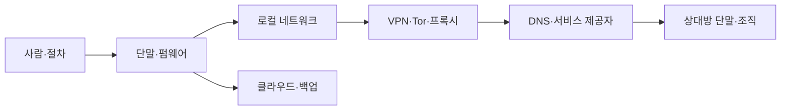

# 기준 위협 모델

위협 모델은 이 백서의 신뢰 경계다. 아래 기준선을 그대로 믿지 말고 [[09_부록/03_위협-모델-워크시트|워크시트]]로 환경에 맞게 수정한다. 자산·상대·노출면·가정 중 하나라도 바뀌면 통제를 재평가한다.

## 보호 목표와 자산

| 자산 | 보호 목표 | 대표 실패 |
|---|---|---|
| 실명·가명·관계 그래프 | 불필요한 연결을 제한 | 계정·연락처·행동 패턴의 상관분석 |
| 인증·복구 비밀 | 탈취·재사용·잠금 방지 | 피싱, 세션 탈취, 복구 채널 장악 |
| 메시지·파일·업무 내용 | 기밀성·무결성·가용성 | 단말 감염, 잘못된 공유, 변조 |
| 위치·시간·네트워크 메타데이터 | 수집과 결합 가능성 축소 | IP·DNS·무선·결제 기록 결합 |
| 단말·운영 상태 | 신뢰할 수 있는 실행과 복구 | 패치 지연, 공급망, 물리 탈취 |
| 백업·키·복구 수단 | 독립성·복구 가능성 | 같은 계정·장소·암호에 동시 의존 |
| 신체 안전과 평판 | 위험한 노출 방지 | 신상 공개, 괴롭힘, 강압 |

## 위협 행위자와 능력

| 등급 | 행위자 | 현실적으로 가정하는 능력 |
|---|---|---|
| T1 | 기회주의자·자동화 공격 | 유출 비밀번호 대입, 대량 피싱, 공개 취약점 악용 |
| T2 | 서비스·로컬 네트워크 관찰자 | 접속 IP·시간·DNS·계정 메타데이터 보유와 결합 |
| T3 | 표적 공격자 | 맞춤형 피싱, 장기 정찰, 공개·상용 데이터 상관분석 |
| T4 | 내부자·권한 공급자 | 관리 로그·복구 절차·서버 측 데이터 접근 |
| T5 | 물리 접근·단말 장악 상대 | 잠금 단말 탈취, 악성코드, 브라우저 세션·화면 접근 |
| T6 | 자원 풍부한 상관분석 상대 | 여러 사업자·시간대·행동 특징의 장기 결합 |

기준선은 T1~T3 위험을 주로 줄이고 T4~T5의 일부 실패를 완화한다. T6에 대한 완전한 보호는 주장하지 않는다. 행위자가 여러 등급의 능력을 결합할 수 있음을 전제로 한다.

## 신뢰 경계

각 경계는 보호 범위가 다르다. 저장 암호화는 켜진 뒤 잠금 해제된 단말의 악성코드를 막지 않는다. VPN은 신뢰를 없애지 않고 ISP에서 VPN 사업자로 일부 옮긴다. 종단간 암호화는 상대방의 촬영·내보내기·감염을 막지 않는다. Tor도 로그인 계정, 문체, 시간 패턴, 손상된 단말의 상관관계를 제거하지 않는다.

## 공격 경로

1. **계정 장악**: 재사용 비밀번호 → 피싱 또는 자격 증명 대입 → 세션·복구 채널 장악 → 다른 계정으로 확장.
2. **단말 장악**: 미패치 앱 또는 악성 파일 → 사용자 권한 실행 → 브라우저·메신저·키 접근 → 암호화 이전/이후 평문 탈취.
3. **신원 연결**: 같은 전화번호·복구 메일·IP·문체·게시 시간 → 가명 간 후보 축소 → 외부 데이터와 결합.
4. **상대방 경유**: 안전한 사용자 → 취약한 협업 상대 → 전달·백업·스크린샷 → 내용과 관계 노출.
5. **복구 실패**: 동일 계정·기기·장소에 키와 백업 집중 → 분실·랜섬웨어·잠금 → 가용성 상실.

## 가정과 비목표

기준 모델은 운영자가 합법적 목적을 갖고, 지원되는 하드웨어와 최신 보안 업데이트를 사용할 수 있으며, 최소 한 개의 독립 복구 경로를 보관할 수 있다고 가정한다. 다음은 보장하지 않는다.

- 이미 완전히 장악된 단말·펌웨어에서의 기밀성
- 수신자의 고의적 공개나 별도 장비로 기록하는 행위 방지
- 강제력 있는 법적 절차나 물리적 강압의 기술적 무력화
- 전 지구적 수동 관찰자에 대한 완전한 익명성
- 제로데이, 구현 결함, 공급망 침해의 완전한 차단
- 문체·습관·사회관계로부터의 상관분석 제거

## 위험 평가

가능성과 영향을 각각 1~5로 평가하고 `고유 위험 = 가능성 × 영향`으로 우선순위를 잡는다. 숫자는 정밀한 확률이 아니라 비교를 위한 의사결정 보조다. 근거의 확신도(낮음·중간·높음), 통제 후 잔여 위험, 위험 수용자를 함께 기록한다. 생명·신체, 법적 구금, 회복 불가능한 신원 노출은 낮은 가능성이라도 높은 영향으로 다룬다.

## 검증 질문

- 자산 소유자와 공격자가 같은 용어로 명확히 식별되는가?
- 통제가 차단하는 공격 경로와 차단하지 못하는 경로가 구분되는가?
- 신뢰하는 공급자·단말·사람이 실패했을 때 대안이 있는가?
- 계정 복구와 백업 복원이 실제로 연습되었는가?
- 모델의 변경 신호와 재검토 책임자가 정해졌는가?

다음 단계: [[01_OPSEC-기초/02_위협-모델링|위협 모델링 절차]] · [[01_OPSEC-기초/03_위험평가와-통제선정|통제 선정]] · [[08_적용-프로파일/00_영역-개요|적용 프로파일]]
