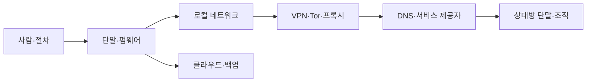

# 기준 위협 모델

위협 모델은 이 백서의 신뢰 경계다. 아래 기준선을 그대로 믿지 말고 [[09_부록/03_위협-모델-워크시트|워크시트]]로 환경에 맞게 수정한다. 자산·상대·노출면·가정 중 하나라도 바뀌면 통제를 재평가한다.

## 보호 목표와 자산

| 자산 | 보호 목표 | 대표 실패 |
|---|---|---|
| 실명·가명·관계 그래프 | 불필요한 연결을 제한 | 계정·연락처·행동 패턴의 상관분석 |
| 인증·복구 비밀 | 탈취·재사용·잠금 방지 | 피싱, 세션 탈취, 복구 채널 장악 |
| 메시지·파일·업무 내용 | 기밀성·무결성·가용성 | 단말 감염, 잘못된 공유, 변조 |
| 위치·시간·네트워크 메타데이터 | 수집과 결합 가능성 축소 | IP·DNS·무선·결제 기록 결합 |
| 단말·운영 상태 | 신뢰할 수 있는 실행과 복구 | 패치 지연, 공급망, 물리 탈취 |
| 백업·키·복구 수단 | 독립성·복구 가능성 | 같은 계정·장소·암호에 동시 의존 |
| 신체 안전과 평판 | 위험한 노출 방지 | 신상 공개, 괴롭힘, 강압 |

## 위협 행위자와 능력

| 등급 | 행위자 | 현실적으로 가정하는 능력 |
|---|---|---|
| T1 | 기회주의자·자동화 공격 | 유출 비밀번호 대입, 대량 피싱, 공개 취약점 악용 |
| T2 | 서비스·로컬 네트워크 관찰자 | 접속 IP·시간·DNS·계정 메타데이터 보유와 결합 |
| T3 | 표적 공격자 | 맞춤형 피싱, 장기 정찰, 공개·상용 데이터 상관분석 |
| T4 | 내부자·권한 공급자 | 관리 로그·복구 절차·서버 측 데이터 접근 |
| T5 | 물리 접근·단말 장악 상대 | 잠금 단말 탈취, 악성코드, 브라우저 세션·화면 접근 |
| T6 | 자원 풍부한 상관분석 상대 | 여러 사업자·시간대·행동 특징의 장기 결합 |

기준선은 T1~T3 위험을 주로 줄이고 T4~T5의 일부 실패를 완화한다. T6에 대한 완전한 보호는 주장하지 않는다. 행위자가 여러 등급의 능력을 결합할 수 있음을 전제로 한다.

## 신뢰 경계

각 경계는 보호 범위가 다르다. 저장 암호화는 켜진 뒤 잠금 해제된 단말의 악성코드를 막지 않는다. VPN은 신뢰를 없애지 않고 ISP에서 VPN 사업자로 일부 옮긴다. 종단간 암호화는 상대방의 촬영·내보내기·감염을 막지 않는다. Tor도 로그인 계정, 문체, 시간 패턴, 손상된 단말의 상관관계를 제거하지 않는다.

## 공격 경로

1. **계정 장악**: 재사용 비밀번호 → 피싱 또는 자격 증명 대입 → 세션·복구 채널 장악 → 다른 계정으로 확장.
2. **단말 장악**: 미패치 앱 또는 악성 파일 → 사용자 권한 실행 → 브라우저·메신저·키 접근 → 암호화 이전/이후 평문 탈취.
3. **신원 연결**: 같은 전화번호·복구 메일·IP·문체·게시 시간 → 가명 간 후보 축소 → 외부 데이터와 결합.
4. **상대방 경유**: 안전한 사용자 → 취약한 협업 상대 → 전달·백업·스크린샷 → 내용과 관계 노출.
5. **복구 실패**: 동일 계정·기기·장소에 키와 백업 집중 → 분실·랜섬웨어·잠금 → 가용성 상실.

## 가정과 비목표

기준 모델은 운영자가 합법적 목적을 갖고, 지원되는 하드웨어와 최신 보안 업데이트를 사용할 수 있으며, 최소 한 개의 독립 복구 경로를 보관할 수 있다고 가정한다. 다음은 보장하지 않는다.

- 이미 완전히 장악된 단말·펌웨어에서의 기밀성
- 수신자의 고의적 공개나 별도 장비로 기록하는 행위 방지
- 강제력 있는 법적 절차나 물리적 강압의 기술적 무력화
- 전 지구적 수동 관찰자에 대한 완전한 익명성
- 제로데이, 구현 결함, 공급망 침해의 완전한 차단
- 문체·습관·사회관계로부터의 상관분석 제거

## 위험 평가

가능성과 영향을 각각 1~5로 평가하고 `고유 위험 = 가능성 × 영향`으로 우선순위를 잡는다. 숫자는 정밀한 확률이 아니라 비교를 위한 의사결정 보조다. 근거의 확신도(낮음·중간·높음), 통제 후 잔여 위험, 위험 수용자를 함께 기록한다. 생명·신체, 법적 구금, 회복 불가능한 신원 노출은 낮은 가능성이라도 높은 영향으로 다룬다.

## 모델의 사용 범위와 분석 단위

이 기준 모델은 특정 개인이 “익명인가 아닌가”를 이분법으로 판정하지 않는다. 하나의 활동, 역할, 시스템 또는 데이터 흐름을 분석 단위로 삼는다. 예를 들어 같은 사람이 공개 기술 블로그, 조직 관리자 계정, 취재원 연락과 개인 금융을 수행한다면 네 활동은 서로 다른 자산·상대·복구 요구를 가진다. 하나의 통제 세트를 전체 삶에 적용하면 불필요한 복잡성과 교차 연결이 동시에 생길 수 있다.

분석 단위마다 다음 식별자를 부여한다.

- **활동 ID**: 목적과 종료 조건이 있는 업무 또는 역할
- **자산 ID**: 내용, 신원, 관계, 위치, 자격 증명, 장치와 복구 수단
- **데이터 흐름 ID**: 생성자, 처리자, 수신자, 저장 위치와 삭제 시점
- **신뢰 경계 ID**: 권한·운영자·법적 통제가 바뀌는 지점
- **위협 시나리오 ID**: 상대의 선행 조건, 행위, 결과가 연결된 서술
- **통제 ID**: 시나리오의 가능성·영향을 줄이는 예방·탐지·복구 수단
- **증적 ID**: 통제가 실제 작동했다는 시험·로그·승인·복원 기록

이 식별 체계는 문서 작업을 늘리기 위한 것이 아니다. “VPN을 쓴다”와 같은 통제 중심 문장을 “NET-S01에서 로컬 관찰자가 목적지를 직접 보는 범위를 줄이기 위해 NET-C04를 적용했고, 장애 시험 NET-E12에서 IPv6 우회가 없음을 확인했다”처럼 검증 가능한 주장으로 바꾸는 장치다.

## 자산 상세 분해

### 내용 자산

메시지, 문서, 사진, 소스 코드, 고객 자료와 조사 기록의 평문뿐 아니라 초안, 자동 저장, 썸네일, OCR 결과, 검색 색인과 번역본을 포함한다. 동일 내용이 메신저, 이메일, 클라우드, 수신자 장치와 백업에 복제되면 각 사본은 별도 보존·삭제 경계를 가진다.

### 신원과 관계 자산

실명·가명, 계정 이름, 전화번호, 이메일, 결제 수단, 복구 연락처, 주소록과 대화 상대를 포함한다. 내용이 암호화되어도 누가 누구와 언제 연락했는지는 민감할 수 있다. 서로 분리하려는 역할의 연결 자체를 보호 자산으로 등록한다.

### 인증 자산

비밀번호, 패스키, FIDO 자격 증명, TOTP 시드, 복구 코드, 세션 쿠키, OAuth 토큰, API 키, SSH 키와 장치 인증서를 포함한다. 장기 비밀뿐 아니라 이미 발급된 세션도 인증 자산이다. 비밀번호를 바꿔도 세션이 유지되는 서비스가 있으므로 철회 경로를 별도로 기록한다.

### 메타데이터 자산

IP, DNS, 무선 식별자, 시간, 파일명·크기·해시, 카메라·문서 속성, 브라우저 특성, 언어와 문체, 이동 경로, 결제와 배송 기록을 포함한다. 개별 항목이 공개 정보여도 결합했을 때 역할과 위치가 드러날 수 있다.

### 가용성 자산

백업, 복구키, 예비 보안 키, 대체 통신, 비상 연락, 운영 절차와 담당자의 지식을 포함한다. OPSEC는 기밀성만 다루지 않는다. 통제가 너무 복잡해 복구하지 못하거나 계정이 영구 잠기면 공격자 없이도 임무가 실패한다.

### 사람과 조직의 안전

신체 안전, 정신적 부담, 고용, 평판, 법적 권리와 협업 상대의 안전을 최상위 자산으로 둔다. 장치나 로그 보전을 위해 사람을 위험에 머물게 하지 않는다. 보호 조치가 상대방에게 추가 위험을 전가하는지 확인한다.

## 행위자 능력의 구성 요소

행위자 등급은 고정된 인물 분류가 아니라 능력의 조합이다. 위협 시나리오마다 다음 능력의 보유 여부와 근거를 쓴다.

1. **공개 정보 수집**: 검색 엔진, 과거 게시물, 도메인·인증서·코드 저장소와 데이터 브로커 자료를 결합한다.
2. **자동화와 규모**: 자격 증명 대입, 취약점 스캔, 스팸·피싱을 대량 수행한다.
3. **맞춤화**: 대상의 이름, 관계, 업무와 최근 사건을 이용해 신뢰도 높은 메시지를 만든다.
4. **네트워크 관찰**: 로컬 무선, ISP, VPN, 서비스 또는 여러 지점의 시간·용량 정보를 본다.
5. **서비스 권한**: 관리 콘솔, 복구 시스템, 로그, 백업 또는 고객 지원 절차에 접근한다.
6. **코드 실행**: 브라우저·문서·앱 취약점, 악성 확장 또는 사용자의 실행 승인을 통해 단말에서 동작한다.
7. **물리 접근**: 잠깐 장치를 만지거나 장기간 압수하고 주변기기·부팅 체인을 변경한다.
8. **사회적·법적 강제**: 동료·가족·지원센터를 압박하거나 적법한 절차로 공급자 기록을 요구한다.
9. **장기 상관분석**: 시간, 장소, 계정, 문체와 행동 반복을 여러 달·여러 출처에서 결합한다.
10. **공급망 영향**: 업데이트, 패키지, 제조·배송, 관리자 또는 신뢰 서비스를 침해한다.

시나리오에는 능력뿐 아니라 **접근 시간**, **예산**, **실패 허용도**, **표적화 동기**를 적는다. 한 번의 기회주의 스캔과 수개월의 표적 작전은 같은 취약점을 이용해도 탐지와 대응 요구가 다르다.

## 신뢰 경계 상세 목록

### 사람과 절차

운영자, 관리자, 협업자, 수신자, 고객 지원과 비상 연락은 기술 경계 밖의 신뢰 주체다. 최소 지식, 역할 분리, 승인과 교육으로 실수를 줄일 수 있지만 고의적 촬영·전달을 기술적으로 완전히 막을 수 없다. 사람을 “가장 약한 고리”라고 부르고 끝내지 않고, 실수해도 피해가 제한되는 흐름을 만든다.

### 단말과 펌웨어

운영체제, 하이퍼바이저, 브라우저, 보안 에이전트, BIOS/UEFI, 보안 칩, 키보드·카메라·USB 장치를 포함한다. Qubes나 샌드박스도 하드웨어와 일부 관리 영역을 공유한다. 패치와 격리는 위험을 낮추지만 알려지지 않은 결함과 공급망 침해를 제거하지 않는다.

### 로컬·접속 네트워크

가정 라우터, 회사 LAN, 공용 Wi-Fi, 이동통신, DNS와 captive portal을 포함한다. HTTPS와 VPN이 내용 노출을 줄여도 접속 시간, 용량, 게이트웨이와 장치 무선 신호는 관찰될 수 있다. 네트워크 이름을 바꾸는 것과 물리 위치를 숨기는 것은 다른 문제다.

### 중계·보호 서비스

VPN, Tor, 프록시, CDN, 이메일 릴레이와 메시지 서버는 경로와 관찰자를 바꾼다. 로그 정책, 소유, 관할, 서버 운영과 계정·결제의 연결성을 평가한다. 감사 보고서는 특정 범위의 증거이지 무조건 신뢰의 인증서가 아니다.

### 애플리케이션·클라우드

서비스 제공자는 계정, 메시지 메타데이터, 파일, 협업 권한, 로그인 기록과 백업을 처리한다. 종단간 암호화가 있어도 앱 배포, 키 확인, 주소록, 알림, 수신자 장치와 신고·남용 처리 경계가 남는다.

### 상대방과 외부 조직

수신자의 단말, 조직 관리자, 법무·감사, 결제·배송사와 하청은 사용자의 통제 밖이다. 공유 전 최소화, 만료, 계약, 별도 채널 확인과 사고 통보가 필요하다. 상대방이 보호 수준을 유지하지 못하면 송신자의 강한 단말 보안만으로는 충분하지 않다.

## 오용·공격 사례 라이브러리

### TM-S01 자격 증명 재사용에서 조직 계정 장악으로

공격자는 외부 유출에서 이메일과 암호를 얻어 조직 로그인에 대입한다. MFA가 없거나 복구 채널이 약하면 세션을 만들고, 메일 규칙·OAuth 앱·API 토큰을 추가해 지속성을 확보한다. 이후 주소록을 이용한 내부 피싱으로 확장한다. 통제는 고유 암호와 암호 관리자, 피싱 저항 MFA, 이상 로그인 탐지, 세션·OAuth 검토, 복구 훈련이다.

### TM-S02 문서 피싱에서 암호화 데이터 유출로

업무 맥락을 아는 공격자가 정상 문서처럼 보이는 파일 또는 링크를 보낸다. 사용자가 잠금 해제된 단말에서 열면 악성 코드가 이미 마운트된 암호화 볼륨과 브라우저 세션에 접근한다. 전체 디스크 암호화는 이 경로를 막지 못한다. 별도 채널 확인, 패치된 뷰어, 매크로 제한, 격리 분석, EDR·로그와 세션 철회가 필요하다.

### TM-S03 역할 간 계정 연결

운영자는 서로 다른 이름과 VPN을 사용하지만 같은 복구 이메일, 브라우저 프로필, 파일 템플릿과 활동 시간대를 반복한다. 서비스 또는 외부 분석자가 여러 약한 표지를 결합해 같은 사람일 가능성을 높인다. 역할별 계정·브라우저·작업 시간과 데이터 경계, 메타데이터 정화, 주기적 교차 오염 점검으로 줄인다.

### TM-S04 협업 링크의 과다 공유

민감 문서가 ‘링크를 아는 모든 사람’ 권한으로 공유되고 메신저·티켓·메일에 복제된다. 원래 수신자가 링크를 전달하거나 검색 색인·브라우저 기록·지원 로그에 남긴다. 명시적 수신자, 최소 권한, 만료, 다운로드 제한, 워터마크의 한계, 접근 로그와 사후 철회를 설계한다.

### TM-S05 이동식 장치 분실

로그인된 노트북 또는 휴대전화가 이동 중 분실된다. 전체 디스크 암호화가 활성이어도 잠금 상태, 세션, 알림과 클라우드 토큰이 남을 수 있다. 강한 잠금, 짧은 자동 잠금, 재부팅 후 강한 인증, 원격 세션 철회, 신속 신고와 복구키·예비 장치가 필요하다.

### TM-S06 백업과 운영 계정 동시 장악

운영 데이터와 백업이 같은 클라우드 계정·동일 관리자 자격 증명에 의존한다. 피싱 또는 랜섬웨어가 원본과 버전 기록을 함께 삭제·암호화한다. 별도 자격 증명, 불변 또는 오프라인 사본, 삭제 지연, 복구키 분리와 정기 복원 시험으로 공통 실패를 줄인다.

### TM-S07 지원센터 복구 우회

공격자는 공개된 생년월일·전화번호·구매 정보를 사용해 계정 소유자로 가장하고 MFA 재설정이나 SIM 교체를 요청한다. 서비스의 복구 정책이 원래 인증보다 약하면 강한 보안 키가 우회된다. 지원 PIN, 포트 아웃 잠금, 복구 연락처 보호, 관리자 이중 승인과 복구 알림이 필요하다.

### TM-S08 공급망과 업데이트 침해

공격자가 패키지, 브라우저 확장, 빌드 계정 또는 업데이트 채널을 침해한다. 정상 서명된 배포물이 악성일 수도 있다. 공식 저장소, 서명·출처 확인, 의존성 최소화, 빌드·배포 권한 분리, SBOM·감사 로그, 신속 철회와 재이미징 계획을 둔다.

### TM-S09 물리적 단기 접근

상대가 호텔·공유 사무실에서 잠시 장치에 접근해 USB 장치, 부팅 설정 또는 케이블을 바꾼다. 봉인만으로 방지됐다고 가정하지 않는다. 장치 휴대·보관, 포트 통제, 부팅 무결성, 변경 흔적 확인, 의심 시 깨끗한 장비 전환을 준비한다.

### TM-S10 사람에 대한 압박과 공개

공격자는 기술 시스템 대신 가족·동료·취재원에게 연락하거나 신상 정보를 공개해 협조를 강요한다. 데이터 최소화, 역할별 연락망, 신고·법률·심리 지원, 대체 연락과 공개 대응 계획이 필요하다. 사람의 안전을 유지하기 위해 일부 시스템을 중단하는 결정도 포함한다.

## 통제 목표와 방어 깊이

통제는 예방·탐지·대응·복구 중 어느 목표를 갖는지 표시한다. 예를 들어 FIDO2 보안 키는 피싱을 통한 새 로그인 가능성을 낮추는 예방 통제지만 이미 탈취된 세션을 자동 폐기하지 않는다. 로그인 알림과 세션 검토는 탐지, 전체 세션 종료와 키 철회는 대응, 예비 키와 복구 코드는 복구 통제다.

하나의 고영향 시나리오에는 가능한 한 서로 다른 실패 원인을 가진 통제를 둔다. 동일 클라우드 계정에 비밀번호, TOTP 백업과 복구 이메일을 모두 두는 것은 겉으로 요소가 여러 개여도 공통 실패다. 반대로 지나친 통제 수는 사용자의 우회와 관리 실패를 부른다. 통제마다 다음 질문을 기록한다.

- 어떤 선행 조건을 차단하거나 어떤 영향을 줄이는가?
- 통제가 실패하거나 꺼졌음을 어떻게 탐지하는가?
- 누가 운영하고 어떤 권한을 갖는가?
- 업데이트·장애·분실 시 복구 방법은 무엇인가?
- 사용자가 우회할 유인은 무엇이며 더 단순한 대안은 있는가?
- 통제 자체가 만드는 개인정보·로그·중앙 집중 위험은 무엇인가?

## 위험 산정 방법

### 가능성

1은 현재 환경에서 특수한 접근과 여러 우연이 필요한 경우, 3은 현실적 동기와 공개 도구로 발생할 수 있는 경우, 5는 이미 관찰됐거나 상시 자동화 공격을 받는 경우로 사용한다. 업계 일반 빈도만으로 정하지 않고 자산 노출, 상대 동기, 필요한 능력과 기존 통제를 근거로 쓴다.

### 영향

기밀성, 무결성, 가용성, 신체·법적·평판 영향을 각각 평가한 뒤 가장 큰 값과 파급 범위를 기록한다. 1은 단기간 복구 가능한 경미한 불편, 3은 제한된 데이터·업무 중단과 통보 필요, 5는 생명·신체 위험, 회복 불가능한 신원 연결, 광범위 침해 또는 장기 운영 중단에 해당할 수 있다.

### 확신도

낮음은 자산·로그·상대 능력에 큰 공백이 있는 경우, 중간은 일부 직접 증거와 합리적 가정이 있는 경우, 높음은 반복 시험·로그·공식 자료로 주요 가정이 확인된 경우다. 높은 위험이면서 확신도가 낮다면 숫자를 정교하게 꾸미기보다 정보 수집과 안전한 임시 통제를 우선한다.

### 잔여 위험과 수용

통제 적용 뒤 가능성과 영향을 다시 평가하되 점수를 자동으로 낮추지 않는다. 실제 시험과 운영 증거가 있어야 한다. 위험 수용자는 남는 결과를 감당할 권한과 자원을 가진 사람이어야 하며, 통제 운영자가 혼자 고영향 위험을 수용하지 않는다. 수용 기한과 재검토 신호를 둔다.

## 적용 프로파일별 기준

### 일반 개인

T1 자동화 공격, 계정 탈취, 장치 분실, 사기와 백업 실패를 우선한다. 암호 관리자, 고유 암호, MFA·패스키, 자동 업데이트, 전체 디스크 암호화, 최소 공유와 복원 가능한 백업이 핵심이다. 복잡한 익명 네트워크와 다중 장치 분리는 명확한 필요가 없으면 도입하지 않는다.

### 소규모 팀

공유 계정, 퇴사자 권한, 관리자 집중, 고객 파일 공유, 피싱과 랜섬웨어를 추가한다. 중앙 ID, 관리자 FIDO2, 장치 목록, 최소 권한, 변경·접근 로그, 오프보딩과 불변 백업을 요구한다. 전담 보안 인력이 없으므로 운영 가능한 소수 통제와 외부 지원 경로가 중요하다.

### 고위험 표적

T3~T6의 맞춤 피싱, 물리 접근, 장기 상관분석, 공급자·상대방 경유와 신체 안전을 포함한다. 역할별 장치·VM/Qubes 구획, Tor Browser, 하드웨어 보안 키, 데이터 최소화, 여행·압수 대응, 안전 연락과 전문가 지원을 검토한다. 완전한 익명이나 국가급 상대에 대한 승리를 보장하지 않는다.

### 여행·국경 통과

필요 최소 데이터, 여행용 단말, 임시 자격 증명과 귀환 후 철회·재이미징을 고려한다. 현지 법률과 조직 정책, 압수·분실·강압 가능성을 사전에 검토한다. 복잡한 은닉 기능이 법적·신체 위험을 높일 수 있으며 기술 판단만으로 결정하지 않는다.

## 검증 시나리오

위협 모델은 문서 검토만으로 검증되지 않는다. 생산 환경을 해치지 않는 범위에서 다음 훈련을 수행한다.

1. 피싱 모의 또는 승인된 테스트 계정으로 보안 키·TOTP의 차이를 확인한다.
2. 분실 장치를 가정해 세션, 보안 키, 인증서와 복구 채널을 철회한다.
3. 새 장치에서 암호 관리자와 암호화 백업을 복원한다.
4. VPN 종료·네트워크 전환 시 승인되지 않은 경로가 차단되는지 패킷으로 본다.
5. 외부 계정으로 공유 링크의 권한·만료·재공유를 시험한다.
6. 협업자 한 명의 계정이 침해됐다고 가정해 접근 범위와 통보 대상을 찾는다.
7. 업데이트 공급자 또는 패키지 하나를 철회하고 대체·롤백 시간을 측정한다.
8. 담당자 부재 상태에서 다른 사람이 문서만으로 핵심 복구를 수행한다.

각 시험은 기대 결과, 실제 결과, 실패 원인, 증적 위치, 위험 재평가와 완료 기한을 남긴다. 성공한 화면 캡처 한 장보다 실패를 발견하고 수정한 기록이 더 강한 증거다.

## 변경 신호와 재검토

정기 3개월 검토 외에도 다음 사건이 발생하면 모델을 즉시 다시 연다.

- 새로운 역할·가명·협업자·서비스 또는 국가가 추가됨
- 자산 분류, 법적 의무, 공개 범위 또는 영향이 바뀜
- 단말·OS·VPN·메신저·암호화 제품을 교체하거나 지원이 종료됨
- 계정 침해, 분실, 피싱, 악성 파일, 잘못된 공유 또는 상관 정황이 발견됨
- 서비스 약관·소유·로그·복구 정책과 감사 범위가 바뀜
- 사용자가 통제를 반복 우회하거나 복구 훈련에 실패함
- 위협 행위자의 동기·자원·물리 접근 가능성이 증가함
- 협업 상대 또는 공급망에서 침해 통보를 받음

변경 검토는 모든 통제를 처음부터 다시 만드는 절차가 아니다. 영향을 받는 자산, 흐름, 경계와 시나리오를 찾아 고유 위험·잔여 위험·증적을 갱신한다. 모델 버전과 변경 이유, 승인자와 다음 검토일을 기록한다.

## 모델의 한계와 오용 방지

위험 점수는 과학적 확률이 아니며 사람을 감시하거나 책임을 전가하는 근거로 쓰지 않는다. 낮은 점수도 신체 안전과 기본권을 침해하면 수용할 수 없다. 공개되지 않은 취약점과 공급망 침해처럼 정보가 부족한 위험은 ‘없음’이 아니라 불확실성으로 기록한다.

이 백서는 합법적 방어, 개인정보 보호, 안전한 운영과 사고 복구를 위한 것이다. 범죄 은폐, 피해자 추적, 강압, 무단 접근 또는 증거 파괴를 정당화하지 않는다. 법률·노무·신체 안전 판단은 관련 전문가와 현지 절차를 병행한다.

## 검증 질문

- 자산 소유자와 공격자가 같은 용어로 명확히 식별되는가?
- 통제가 차단하는 공격 경로와 차단하지 못하는 경로가 구분되는가?
- 신뢰하는 공급자·단말·사람이 실패했을 때 대안이 있는가?
- 계정 복구와 백업 복원이 실제로 연습되었는가?
- 모델의 변경 신호와 재검토 책임자가 정해졌는가?

다음 단계: [[01_OPSEC-기초/02_위협-모델링|위협 모델링 절차]] · [[01_OPSEC-기초/03_위험평가와-통제선정|통제 선정]] · [[08_적용-프로파일/00_영역-개요|적용 프로파일]]
