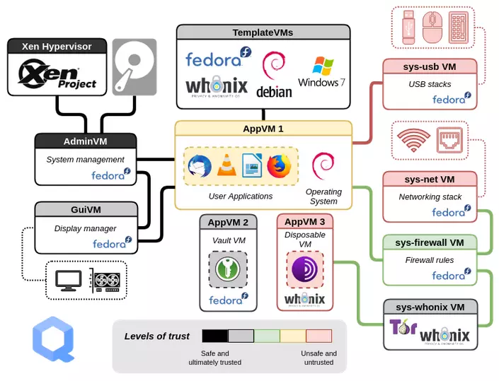

# 플랫폼 선정과 격리

## 선정 기준

먼저 지원 종료일과 보안 업데이트 속도를 본다. 하드웨어 보안 기능, 저장 암호화, 앱 격리와 권한 모델, 보안 로그, 복구 가능성, 접근성 도구도 선택을 좌우한다. Windows·macOS·Linux·ChromeOS 가운데 어느 하나를 일률적으로 금지해서는 위협 모델을 대신할 수 없다. 패치와 관리가 꾸준한 일반 플랫폼이 방치된 특수 플랫폼보다 나을 때도 있다.

BitLocker, FileVault와 Linux의 저장 암호화는 분실되거나 전원이 꺼진 기기의 데이터 노출을 줄이는 유효한 통제다. 다만 잠금 해제된 세션, 악성코드, 약한 복구키 보관, 관리자가 가진 키에는 별도 통제가 필요하다.

## 격리 수준

브라우저 프로필·별도 사용자 계정은 쿠키와 일상 설정의 혼합을 줄이지만 운영체제 장악을 막는 강한 경계는 아니다. 가상 머신은 소프트웨어 경계를 추가하지만 호스트와 하이퍼바이저를 신뢰한다. 별도 단말은 관리 부담과 물리적 연결 신호가 늘어난다.

Qubes OS는 Xen 기반 구획으로 작업을 분리할 수 있으나 호환 하드웨어, 메모리, 업데이트와 데이터 이동 규칙을 요구한다. Whonix는 Tor 경로를 게이트웨이와 워크스테이션으로 분리하지만 손상된 호스트, 식별 가능한 로그인, 행동 상관분석을 해결하지 않는다. 특수 플랫폼은 [[00_백서-안내/03_기준-위협-모델|위협 모델]]이 추가 복잡성을 정당화할 때 선택한다.

  
   
  Qubes OS의 구획과 Whonix Gateway·Workstation 분리를 설명하는 구조 개요

## 검증

부팅 보호, 자동 업데이트, 저장 암호화 상태, 복구키 위치, 관리자 권한, 격리 경계 사이의 클립보드·공유 폴더·USB 정책을 확인한다. 경계를 우회해야 업무가 가능한지 관찰하고, 반복 우회가 있다면 설계를 단순화한다.
