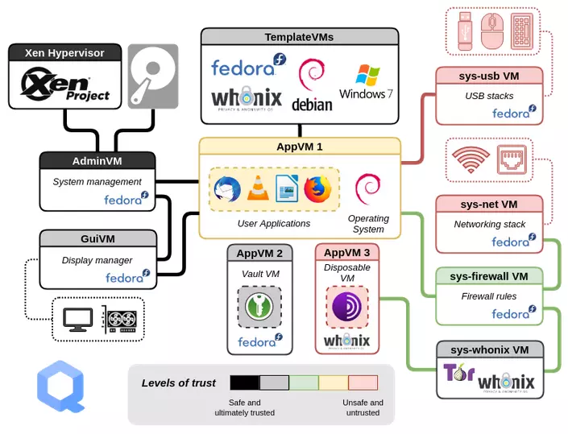
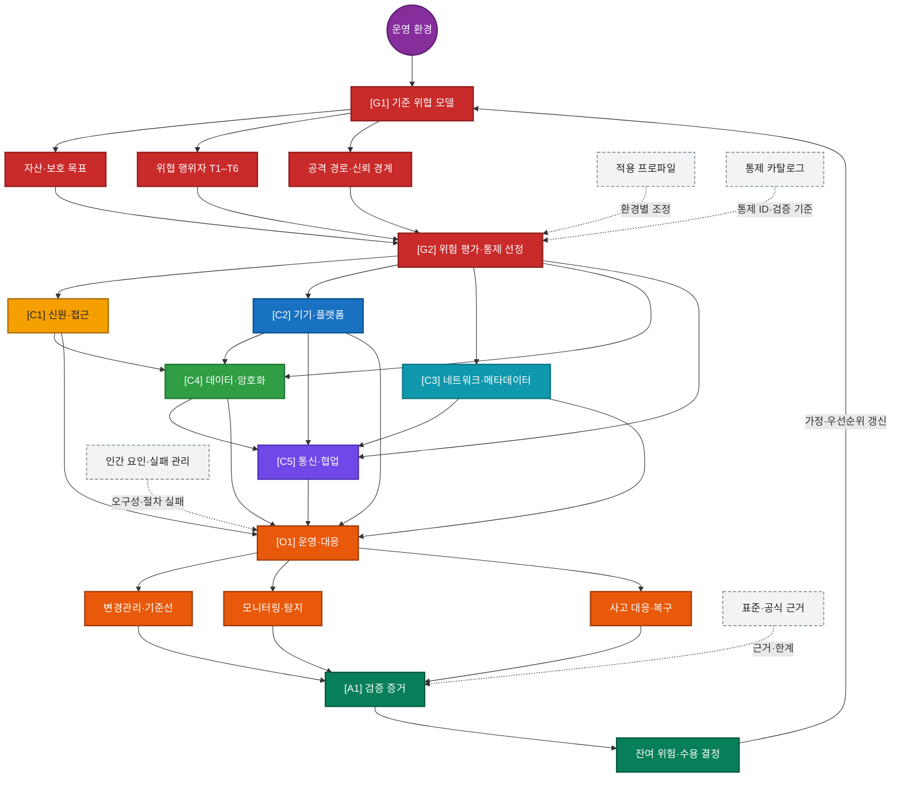

# Operational Security 운영 보안 한국어 백서

## 한국어 기술 백서 및 실무 로드맵

*Threat-Model-Driven Operational Security: A Korean White Paper and Implementation Roadmap*

**문서 식별자:** OPSEC-KR-WP-001 · **유형:** 기술 백서 · **버전:** 1.0 · **상태:** 검토 기준선 · **기준일:** 2026-11-08

  
   
  Qubes OS 구획 및 Whonix Gateway·Workstation 격리 구조

## 초록

운영 보안은 특정 도구의 우열이나 익명성 기법을 나열하는 작업이 아니다. 보호할 자산, 상대의 능력, 관찰 가능한 지표와 신뢰 경계를 식별하고, 현실적인 공격 경로에 맞춰 예방·탐지·복구 통제를 선택한 뒤 그 효과를 검증하는 수명주기다.

본 백서는 개인과 소규모 조직을 대상으로 신원과 접근, 단말과 플랫폼, 네트워크 메타데이터, 데이터 암호화, 통신, 모니터링과 사고 대응을 하나의 위험 관리 체계로 통합한다. 방법론은 [기준 위협 모델](00_백서-안내/03_기준-위협-모델.md)을 중심으로 자산·위협 행위자·신뢰 경계·공격 경로·가정·비목표를 명시하고, 통제마다 적용 조건, 검증 증거와 잔여 위험을 연결하는 방식이다. 특정 운영체제나 서비스가 모든 환경의 정답이라고 가정하지 않으며, 복잡성이 만드는 오구성과 복구 실패도 독립된 위험으로 평가한다.

**주제어:** OPSEC, 운영 보안, 위협 모델링, 위험 평가, 신원 보호, 메타데이터, 단말 보안, 사고 대응

## Knowledge Graph (관계성 지도)

**탐색:** [OPSEC 지식그래프 허브](09_부록/08_OPSEC-지식그래프-허브.md) · [기준 위협 모델](00_백서-안내/03_기준-위협-모델.md) · [참고문헌](09_부록/05_참고문헌.md) · [품질 검증 기록](09_부록/07_품질-검증.md)

이 Vault는 문서를 단순한 장 목록이 아니라 위협 모델 → 위험 평가 → 통제 영역 → 운영·대응 → 검증 증거 → 위협 모델 갱신의 폐루프로 연결한다. 실선은 통제 결정이나 운영 결과가 다음 노드의 입력이 되는 관계를, 점선은 적용 환경에 따라 통제를 조정하는 관계를 뜻한다.

> [!TIP]
> **Obsidian에서 관계 지도 열기:** [OPSEC 관계성 지도](00_백서-안내/OPSEC%20관계성%20지도.canvas)를 열면 핵심 문서와 관계를 이동·확대할 수 있는 Canvas로 탐색할 수 있다. 전체 링크망은 Obsidian의 Graph View에서 확인한다.

### 레이어별 읽기

- 🔴 **거버넌스:** 운영 환경 → 위협 모델 → 위험 평가. 자산·상대·공격 경로가 통제 우선순위를 결정하는지 확인한다.
- 🟡 🔵 🟢 🟣 **핵심 통제:** 위험 평가 → 신원·단말·네트워크·데이터·통신. 통제가 보호 대상과 신뢰 경계에 직접 대응하는지 확인한다.
- 🟠 **운영화:** 통제 → 변경관리·탐지·사고 대응. 통제가 반복 가능한 운영 및 복구 절차로 구현되는지 확인한다.
- 🟢 **보증·환류:** 검증 증거 → 잔여 위험 → 위협 모델 갱신. 시험 결과와 한계가 다음 위험 평가에 반영되는지 확인한다.
- ⚪ **횡단 인터페이스:** 프로파일·인간 요인·카탈로그·근거가 핵심 경로를 보완한다. 환경과 증거가 기준선을 조정하되 판단을 대체하지 않는지 확인한다.

### 문서 접근 경로

- [백서 안내](00_백서-안내/00_백서-홈.md) — 범위, 규범어, 위협 모델, 문서 거버넌스
- [OPSEC 기초](01_OPSEC-기초/00_영역-개요.md) — 수명주기, 위험 평가, 인간 요인
- [신원과 접근](02_신원과-접근/00_영역-개요.md) — 신원 분리, 인증, 복구
- [기기와 플랫폼](03_기기와-플랫폼/00_영역-개요.md) — 플랫폼 선정, 격리, 패치, 물리 위험
- [네트워크와 메타데이터](04_네트워크와-메타데이터/00_영역-개요.md) — 관찰면, VPN·Tor, DNS, 무선
- [데이터와 암호화](05_데이터와-암호화/00_영역-개요.md) — 분류, 키, 백업, 파일 교환
- [통신과 협업](06_통신과-협업/00_영역-개요.md) — 메시징, 상대방 위험, 게시
- [운영과 대응](07_운영과-대응/00_영역-개요.md) — 변경, 탐지, 사고 대응, 훈련
- [적용 프로파일](08_적용-프로파일/00_영역-개요.md) — 일반 개인, 소규모 팀, 고위험 표적, 여행
- [부록](09_부록/00_영역-개요.md) — 통제 카탈로그, 워크시트, 점검표, 참고문헌과 품질 검증

## 빠른 시작

1. [기준 위협 모델](00_백서-안내/03_기준-위협-모델.md)에서 자산·상대·가정을 확인한다.
2. [워크시트](09_부록/03_위협-모델-워크시트.md)로 자신의 상황을 작성한다.
3. [위험 평가](01_OPSEC-기초/03_위험평가와-통제선정.md) 후 필요한 통제만 선택한다.
4. 가장 가까운 [적용 프로파일](08_적용-프로파일/00_영역-개요.md)을 기준선으로 삼는다.
5. 통제를 설치한 사실이 아니라, 시험 결과와 복구 가능성을 증거로 남긴다.

## 안전과 한계

이 문서는 완전한 익명성, 추적 불가능성 또는 법적 면책을 보장하지 않는다. 침해된 단말, 악성 펌웨어, 상대방의 기록, 행동·문체 상관분석, 강제력 있는 법적 절차, 알려지지 않은 취약점은 기술 통제만으로 해결되지 않을 수 있다. 불법 행위, 증거 훼손, 수사 회피를 위한 지침은 범위 밖이다. 생명·신체 또는 법률 위험이 있으면 자가 판단보다 자격 있는 전문가와 지역 지원기관을 우선한다.

문서 버전: 1.0 · 기준일: 2026-11-08 · 상태: 검토 기준선

---

## Create with by

  

